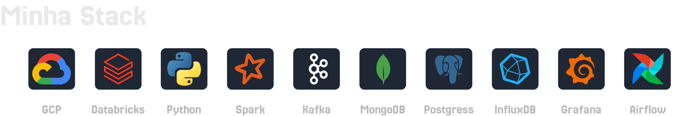

### Oi, visitante!

 

  <picture>
    <source media="(prefers-color-scheme: dark)" srcset="./Stack-dark.svg">
    <source media="(prefers-color-scheme: light)" srcset="./Stack.svg">
    
  </picture>

## 🛠️ Projetos mais recentes
### [steam-feedbacks-classifier](https://github.com/lucasIsy/steam-feedbacks-classifier) | Batch
A arquitetura automatiza a extração de conteúdo útil dentre milhares de textos não estruturados(reviews ou feedbacks), permitindo encontrar rapidamente:
1. Problemas críticos ou recorrentes
2. Monitorar a efetividade das atualizações
3. Encontrar as áreas prioritárias no desenvolvimento do jogo ou serviço.
> Apresenta uma solução baseada em 3 pilares: **Filtragem(SQL + IA)**, **Fragmentação(IA)**, **Classificação(Embeddings, Herança por Proximidade Semântica, VectorDB)**

### [Gerenciador-de-bateria-inteligente](https://github.com/lucasIsy/Gerenciador-de-bateria-inteligente) | Streaming
Pipeline em streaming que gerencia o consumo de múltiplos IoT em baterias fotovoltaicas, permitindo que os dispositivos mais críticos possam operar durante a noite ou em situações de emergência. 
1. Economia gerada
2. Alertas de capacidade restante
3. Monitoramento em tempo real
> Projeto de estudos sobre pipelines IoT, streaming de dados e observabilidade.
